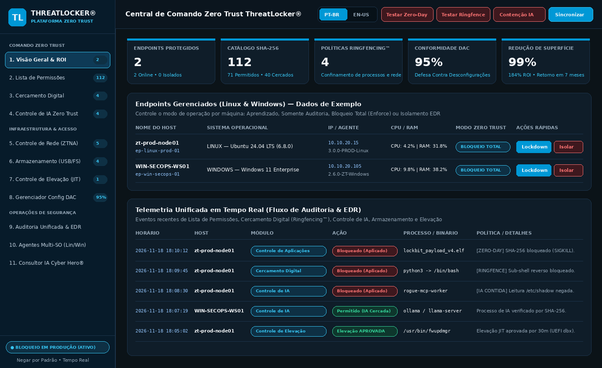
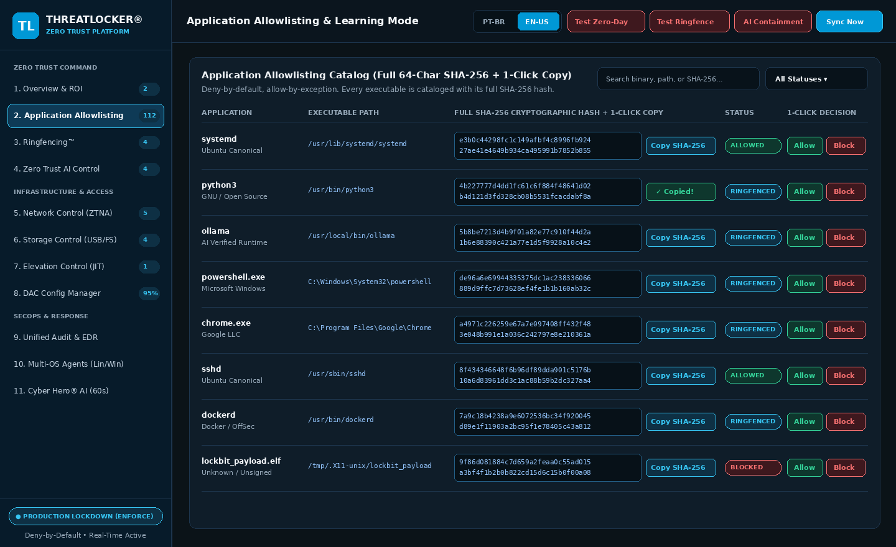
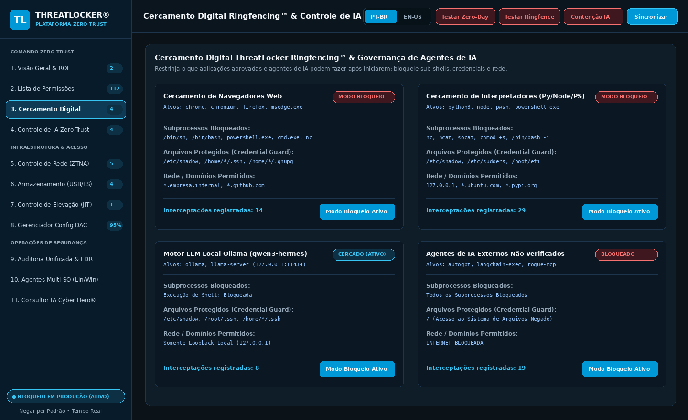

# 🛡️ ThreatLocker® Zero Trust Endpoint Protection Platform (Open Reconstruction)


Plataforma completa de **Gerenciamento de Cibersegurança Zero Trust** inspirada na arquitetura **ThreatLocker® Zero Trust Endpoint Protection** (*"Deny-by-default, allow-by-exception"*), com Servidor Central (Control Plane WSGI/Gunicorn), Interface Web 100% Bilíngue (**Português `PT-BR`** e **Inglês `EN-US`**), Agentes Multiplataforma (**Linux** & **Windows PowerShell/Python**) e consultor **Cyber Hero® AI**.

---

## 🖼️ Demonstração Visual (Exemplos)

### 1. Central de Comando Zero Trust & Telemetria em Tempo Real (`PT-BR`)


### 2. Application Allowlisting com Hash SHA-256 Completo (64 Caracteres) e Cópia em 1 Clique (`EN-US`)


### 3. Cercamento Digital (Ringfencing™) & Governança de Agentes de IA (`PT-BR`)


---

## 🚀 Principais Módulos Zero Trust

1. **Application Allowlisting & Learning Mode (`SHA-256` Completo + Cópia em 1 Clique)**
   - Inventário automático em tempo real de todos os binários em execução nos endpoints (`/proc/<pid>/exe` no Linux e `Get-Process` + `Authenticode` no Windows).
   - Exibição integral do hash criptográfico **SHA-256 de 64 caracteres** com botão de cópia rápida (`📋 Copiar SHA-256` / `📋 Copy SHA-256`).
   - Bloqueio ativo (**Production Lockdown / `SIGKILL`**) de qualquer executável cujo hash criptográfico SHA-256 ou caminho esteja bloqueado, protegendo a baseline crítica do sistema operacional.
2. **Ringfencing™ (Cercamento Digital de Processos, Arquivos e Rede)**
   - Restringe o que aplicações confiáveis (navegadores, suítes Office, interpretadores `python3`, `node`, `powershell.exe` e containers) podem fazer após iniciarem.
   - Bloqueia ataques *Living-off-the-Land (LOTL)* impedindo que processos confinados criem shells filhos (`/bin/bash`, `/bin/sh`, `cmd.exe`, `nc`) ou leiam credenciais (`/etc/shadow`, `~/.ssh`).
3. **Zero Trust AI Control**
   - Governança dedicada para agentes de IA autônomos (**Ollama**, **Hermes Agent**, **MCP Servers**, **AutoGPT**), restringindo diretórios de workspace permitidos, execução de shell e acesso externo à rede.
4. **Network Control (Host Firewall & Dynamic ZTNA ACLs)**
   - Integração com **UFW / iptables** (Linux) e **Windows Defender Firewall** para fechar portas abertas, bloquear movimentação lateral SMB/RPC (`135, 139, 445`) e portas de Reverse Shell (`4444, 1337, 9001`).
5. **Storage Control**
   - Controle granular sobre dispositivos **USB Mass Storage**, partições críticas (`/boot/efi`), volumes de dados e cofres de chaves SSH contra exfiltração de dados.
6. **Elevation Control (Just-In-Time PAM)**
   - Remoção de privilégios permanentes com fluxo de solicitação, justificativa e aprovação temporária (`sudo` / UAC) por comando e hash SHA-256.
7. **DAC — Defense Against Configurations**
   - Monitoramento contínuo de deriva de configuração (*Configuration Drift*): ASLR do Kernel, Firmware UEFI Secure Boot `dbx`, Fail2Ban, UFW, Ubuntu Pro ESM, Microsoft Defender e isolamento de containers.
8. **Unified Audit & EDR + Host Isolation**
   - Telemetria forense unificada em tempo real e isolamento instantâneo de endpoints comprometidos (**Host Quarantine**).
9. **Cyber Hero® AI Advisor & Interface 100% Bilíngue (`PT-BR` / `EN-US`)**
   - Seletor instantâneo de idioma no topo do painel (`🇧🇷 PT-BR` | `🇺🇸 EN-US`) que traduz integralmente menus, tabelas, políticas, status, logs de auditoria e respostas do consultor **Cyber Hero® AI**.

---

## 🏗️ Arquitetura do Projeto

```text
threatlocker-zt/
├── server/
│   ├── app.py                 # Control Plane API & Motor de Políticas Zero Trust (Flask / Gunicorn)
│   └── static/
│       └── index.html         # Portal Web Responsivo Bilíngue (PT-BR / EN-US) com 11 Módulos
├── agents/
│   ├── linux/
│   │   └── tl_agent_linux.py  # Agente de Produção Linux (SHA-256, Ringfencing SIGKILL, DAC, UFW)
│   └── windows/
│       ├── ThreatLockerAgent.ps1  # Agente Nativo Windows PowerShell (SHA-256 + Authenticode + Defender)
│       └── tl_agent_windows.py    # Agente Windows Python Multiplataforma
├── docs/
│   └── images/                # Capturas de tela ilustrativas (dados de exemplo sanitizados)
├── scripts/
│   └── install_systemd.sh     # Script de instalação automatizada dos serviços systemd em produção
├── requirements.txt
└── LICENSE
```

---

## 💻 Requisitos de Sistema / System Requirements

### 🇧🇷 Português (BR) — Configuração Mínima & Recomendada

A arquitetura da **ThreatLocker® Zero Trust Endpoint Protection Platform** permite operar em três perfis de hardware, dependendo se a máquina executa apenas o **Agente de Endpoint (Linux/Windows)**, o **Servidor Central (Control Plane WSGI/Gunicorn)** sem inferência local, ou a stack completa com o consultor **Cyber Hero® AI** via **Ollama**:

| Recurso | 🟢 Mínimo (Apenas Agente Endpoint Linux/Windows) | 🟡 Intermediário (Control Plane + Agentes, sem LLM Local) | 🔵 Recomendado (Control Plane + Cyber Hero® AI Local) |
| :--- | :--- | :--- | :--- |
| **CPU** | **1 vCPU** (`x86_64` / `arm64`) | **2 vCPUs** (`x86_64` / `amd64`) | **4 a 8+ vCPUs** (`x86_64` c/ AVX2) |
| **Memória RAM** | **512 MB RAM** (consumo do agente < 80 MB) | **2 GB RAM** (+ 1 GB Swap) | **8 GB a 16 GB+ RAM** |
| **Armazenamento (SSD)** | **500 MB livres** (scripts do agente + cache de hashes) | **10 GB livres** (SO + SQLite WAL + logs de auditoria) | **30 GB+ SSD NVMe** (telemetria contínua + modelos Ollama locais) |
| **GPU (Opcional)** | Não necessária | Não necessária (ou LLM em servidor remoto) | **NVIDIA 4 GB a 8 GB+ VRAM** (CUDA p/ `qwen3-hermes:latest`) |
| **Sistema Operacional** | Ubuntu / Debian / Kali Linux ou Windows 10/11 / Server 2019+ | Ubuntu 22.04 / 24.04 LTS, Debian 12+ ou Kali Linux | Ubuntu 24.04 LTS (Control Plane) + Endpoints Linux/Windows |

#### 📦 Consumo por Componente da Arquitetura
- **Servidor Central & Portal Web (`threatlocker-zt.service` — Gunicorn 4 workers × 4 threads na porta `9443` + Flask + SQLite WAL)**: ~150 MB a 350 MB de RAM.
- **Agente Linux (`threatlocker-agent.service` — `tl_agent_linux.py`, hashing SHA-256 `/proc/<pid>/exe`, Ringfencing `SIGKILL`, DAC, UFW/iptables)**: ~25 MB a 60 MB de RAM.
- **Agente Windows (`ThreatLockerAgent.ps1` PowerShell nativo ou `tl_agent_windows.py`, SHA-256 + Authenticode + Defender/Firewall)**: ~30 MB a 80 MB de RAM.
- **Consultor Cyber Hero® AI (`Ollama` em `127.0.0.1:11434`)**:
  - **Sem LLM Local / Endpoint Remoto**: Consumo zero de VRAM/CPU local.
  - **Modo Local (`qwen3-hermes:latest`)**: Requer ~3.5 GB de RAM/VRAM para modelos 4B quantizados ou ~5 GB a 6 GB de RAM/VRAM para modelos 7B–9B.

#### 🛠️ Dependências de Software
- **Servidor Central (Control Plane)**: `Python 3.10+`, `Flask >= 3.0.0`, `Gunicorn >= 21.2.0`, `Requests >= 2.31.0`, `SQLite 3` (embutido), `systemd` (instalado via `scripts/install_systemd.sh`)
- **Agente Linux & Hardening**: `Python 3.10+` (biblioteca padrão), privilégios `root` (`sudo`), `ufw` / `iptables`, `systemctl` (opcional: `fail2ban`)
- **Agente Windows**: `PowerShell 5.1+` / `PowerShell 7+` (como Administrador) ou `Python 3.10+`, Windows Defender Firewall (`NetSecurity`)
- **IA Local (Opcional)**: `Ollama` + modelo `qwen3-hermes:latest` (ou compatível)

### 🇺🇸 English — Minimum & Recommended Configuration

The architecture of the **ThreatLocker® Zero Trust Endpoint Protection Platform** supports three hardware profiles depending on whether the host runs only the **Endpoint Agent (Linux/Windows)**, the **Control Plane WSGI/Gunicorn Server** without local inference, or the full stack with the **Cyber Hero® AI** advisor powered by **Ollama**:

| Resource | 🟢 Minimum (Endpoint Agent Only — Linux/Windows) | 🟡 Intermediate (Control Plane + Agents, No Local LLM) | 🔵 Recommended (Control Plane + Local Cyber Hero® AI) |
| :--- | :--- | :--- | :--- |
| **CPU** | **1 vCPU** (`x86_64` / `arm64`) | **2 vCPUs** (`x86_64` / `amd64`) | **4 to 8+ vCPUs** (`x86_64` w/ AVX2) |
| **RAM** | **512 MB RAM** (agent footprint < 80 MB) | **2 GB RAM** (+ 1 GB Swap) | **8 GB to 16 GB+ RAM** |
| **Storage (SSD)** | **500 MB free** (agent scripts + hash cache) | **10 GB free** (OS + SQLite WAL + audit logs) | **30 GB+ NVMe SSD** (continuous telemetry + local Ollama models) |
| **GPU (Optional)** | Not required | Not required (or remote LLM endpoint) | **NVIDIA 4 GB to 8 GB+ VRAM** (CUDA for `qwen3-hermes:latest`) |
| **Operating System** | Ubuntu / Debian / Kali Linux or Windows 10/11 / Server 2019+ | Ubuntu 22.04 / 24.04 LTS, Debian 12+, or Kali Linux | Ubuntu 24.04 LTS (Control Plane) + Linux/Windows Endpoints |

#### 📦 Resource Usage by Architecture Component
- **Control Plane & Web Portal (`threatlocker-zt.service` — Gunicorn 4 workers × 4 threads on port `9443` + Flask + SQLite WAL)**: ~150 MB to 350 MB RAM.
- **Linux Agent (`threatlocker-agent.service` — `tl_agent_linux.py`, SHA-256 `/proc/<pid>/exe`, Ringfencing `SIGKILL`, DAC, UFW/iptables)**: ~25 MB to 60 MB RAM.
- **Windows Agent (`ThreatLockerAgent.ps1` native PowerShell or `tl_agent_windows.py`, SHA-256 + Authenticode + Defender/Firewall)**: ~30 MB to 80 MB RAM.
- **Cyber Hero® AI Advisor (`Ollama` at `127.0.0.1:11434`)**:
  - **No Local LLM / Remote Endpoint**: Zero local VRAM/CPU usage.
  - **Local Mode (`qwen3-hermes:latest`)**: Requires ~3.5 GB RAM/VRAM for 4B quantized models or ~5 GB to 6 GB RAM/VRAM for 7B–9B models.

#### 🛠️ Software Dependencies
- **Control Plane Server**: `Python 3.10+`, `Flask >= 3.0.0`, `Gunicorn >= 21.2.0`, `Requests >= 2.31.0`, `SQLite 3` (built-in), `systemd` (configured via `scripts/install_systemd.sh`)
- **Linux Agent & Hardening**: `Python 3.10+` (standard library), `root` (`sudo`) privileges, `ufw` / `iptables`, `systemctl` (optional: `fail2ban`)
- **Windows Agent**: `PowerShell 5.1+` / `PowerShell 7+` (Administrator) or `Python 3.10+`, Windows Defender Firewall (`NetSecurity`)
- **Local AI (Optional)**: `Ollama` + `qwen3-hermes:latest` model (or compatible)

---

## ⚡ Instalação Rápida (Modo Produção)

### 1. Servidor Central + Agente Linux (Ubuntu / Debian / Kali)

```bash
git clone https://github.com/heavyscan/threatlocker-zt.git
cd threatlocker-zt
pip3 install -r requirements.txt
sudo bash scripts/install_systemd.sh
```

O painel estará disponível em:
- **Local**: `http://127.0.0.1:9443`
- **Rede Local (LAN / Wi-Fi)**: `http://<IP_DO_SERVIDOR>:9443`

### 2. Conectar um Endpoint Windows (PowerShell como Administrador)

```powershell
Invoke-WebRequest -Uri "http://<IP_DO_SERVIDOR>:9443/api/agents/download/windows-ps1" -OutFile ThreatLockerAgent.ps1
powershell -ExecutionPolicy Bypass -File .\ThreatLockerAgent.ps1 -ServerUrl "http://<IP_DO_SERVIDOR>:9443"
```

---

## 📄 Licença
Distribuído sob a licença **MIT**. Veja [LICENSE](LICENSE) para mais detalhes.
